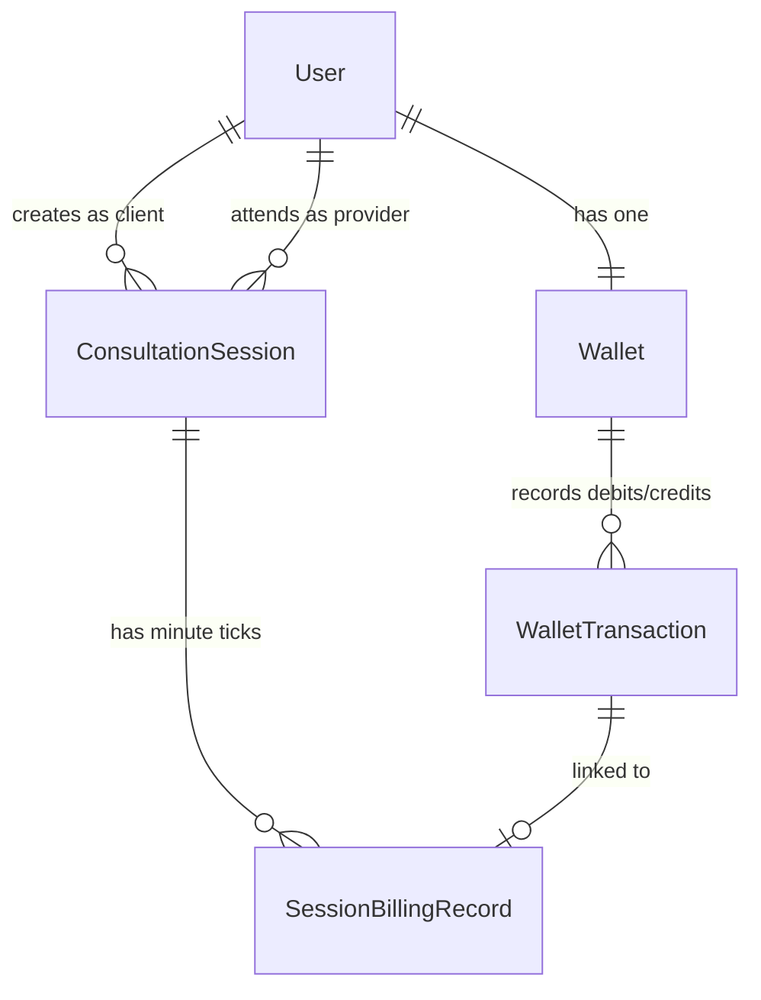
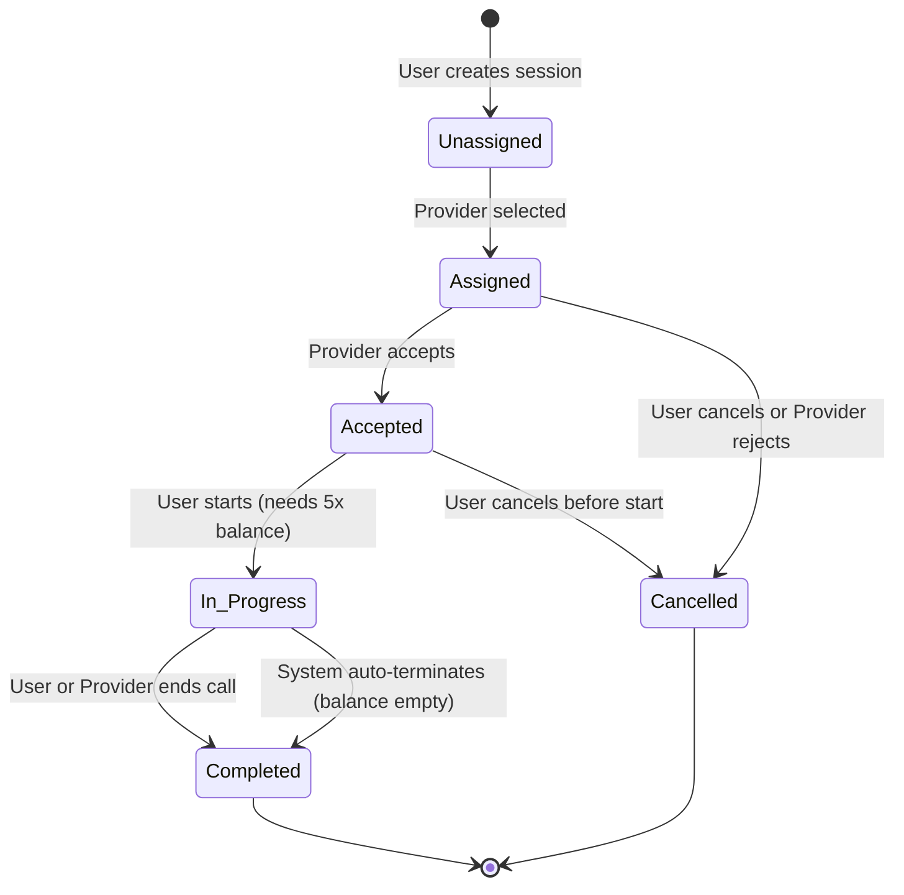

# Django Wallet-Based Consultation Billing

A clean backend system for paid 1-on-1 consultations with real-time per-minute wallet billing, built using **Django**, **Django REST Framework (DRF)**, and **PostgreSQL**.

---

## 📌 What This Project Does

In consultation platforms (like astrology, medical advice, or tutoring), users talk to providers and pay per minute from a prepaid balance. 

This project handles that entire flow reliably:
1. **Users recharge their wallet** with a mock payment flow.
2. **Users request a session** with a provider at a fixed per-minute rate.
3. **Provider accepts**, and the session starts once the user has at least 5 minutes worth of balance.
4. **Billing happens per minute**: Each minute deducts the rate from the user's wallet.
5. **If the money runs out**, the session automatically terminates. The wallet never drops below ₹0.
6. **When the session ends**, any unbilled minutes are automatically calculated and deducted.

---

## 🏗️ How Data Connects (ER Diagram)

Here is a simple look at how the main tables relate to each other:



* **User**: Can be a regular client (`USER`) or an astrologer/consultant (`PROVIDER`).
* **Wallet & WalletTransaction**: Tracks current balance and an audit trail of every recharge and minute debit.
* **ConsultationSession**: Tracks the call status, fixed rate, start/end times, and duration.
* **SessionBillingRecord**: One entry per billed minute (`minute_number: 1, 2, 3...`) to guarantee no minute is ever charged twice.

---

## 🔄 Session State Machine

A consultation moves through a predictable lifecycle:



---

## 💡 Important Design Decisions

Here is a quick look at why things are built the way they are:

### 1. Stopping Race Conditions (`select_for_update`)
When handling money, two requests hitting the server at the exact same millisecond (like double-clicking "Start" or concurrent billing ticks) could lead to double debits or negative balances. We use PostgreSQL row-level locking (`select_for_update()`) inside atomic transactions. If a transaction is modifying a wallet, all other requests wait in line.

### 2. Minute-Level Idempotency
Each billable minute is tied to an explicit `(session_id, minute_number)` database constraint. Even if network latency causes a billing tick to fire twice, the second tick sees the minute record already exists and skips it safely.

### 3. Auto-Billing When a Session Ends
If a user talks for 10 minutes and hangs up, they shouldn't get those minutes for free just because a periodic background worker hasn't ticked yet. The `end_session` method checks the elapsed time, settles any unbilled minutes on the spot, and then closes the session.

### 4. Safe Auto-Termination on Zero Balance
If a user runs out of funds during a call, the system doesn't let the wallet go negative. The moment balance is less than 1 minute's fee, the session status is switched to `COMPLETED`, `ended_by="system"`, and `end_reason="Insufficient Balance"`.

### 5. Services Keep Code Organized
Views and serializers only handle incoming JSON, permissions, and HTTP status codes. All business logic (pricing, balance verification, state machine transitions) lives inside dedicated service classes (`WalletService`, `SessionService`, `BillingService`). This makes the code easy to test, maintain, and reason about.

---

## 🚀 Quick Setup Guide

### Prerequisites
- Python 3.11+
- PostgreSQL (or SQLite for quick local test runs)

### 1. Clone & Setup Virtual Environment
```bash
# Clone the repository
git clone <your-repo-url>
cd "Astrokarma - Django Wallet-Based"

# Create a virtual environment
python -m venv venv

# Activate it
# On Windows:
.\venv\Scripts\activate
# On Linux / macOS:
source venv/bin/activate

# Install dependencies
pip install -r requirements.txt
```

### 2. Configure Environment Variables
Copy `.env.example` to `.env`:
```bash
cp .env.example .env
```

Open `.env` and verify your local database settings:
```ini
DEBUG=True
SECRET_KEY=your-secret-key-here
ALLOWED_HOSTS=*

# Database
DB_NAME=astrokarma_db
DB_USER=postgres
DB_PASSWORD=postgres
DB_HOST=localhost
DB_PORT=5432

# Optional webhook secret for payment callbacks
WEBHOOK_SECRET=
```

> **Tip:** If you don't have PostgreSQL running locally and want to test immediately, Django's default sqlite engine can be temporarily configured in `config/settings.py` or run directly with pytest.

### 3. Run Migrations & Start Server
```bash
python manage.py migrate
python manage.py runserver
```

The server will be live at `http://127.0.0.1:8000/`.

---

## 🧪 Running the Tests

The project includes an automated test suite covering all mandatory scenarios and edge cases (race conditions, IDOR checks, duplicate webhooks, zero balances, rate locks).

To run the complete test suite:

```bash
pytest -v
```

### Key Scenarios Covered (32 Tests):
- **Insufficient Balance on Start:** Users with less than 5 minutes of balance cannot start a session.
- **Happy Path:** Recharge -> Create -> Accept -> Start -> Bill -> End.
- **Balance Exhaustion:** Session automatically ends mid-call with `ended_by="system"` and `end_reason="Insufficient Balance"`. Wallet never drops below zero.
- **Auto-Billing on End:** Ending a call settles all elapsed minutes automatically.
- **Idempotency:** Repeating identical recharge callbacks or billing ticks never charges or credits twice.
- **Single Active Session Rule:** Users and providers cannot join multiple concurrent live consultations.
- **Anti-Tampering & Security:** IDOR prevention on billing endpoints, prevention of self-consultations, and protection against reference collisions.

---

## 📬 API Cheatsheet (Postman)

A pre-configured [`postman_collection.json`](postman_collection.json) is included in the project root with test scripts that automatically save authentication tokens.

| Method | Endpoint | Description |
|---|---|---|
| `POST` | `/api/v1/auth/register/` | Register a new `USER` or `PROVIDER` |
| `POST` | `/api/v1/auth/login/` | Log in and receive auth token |
| `GET`  | `/api/v1/auth/me/` | Current user profile |
| `GET`  | `/api/v1/wallet/` | Check wallet balance & recent transactions |
| `GET`  | `/api/v1/wallet/transactions/` | Paginated transaction history |
| `POST` | `/api/v1/wallet/recharge/initiate/` | Start a mock recharge |
| `POST` | `/api/v1/wallet/recharge/callback/` | Payment webhook callback (idempotent) |
| `POST` | `/api/v1/sessions/` | Request a consultation session |
| `GET`  | `/api/v1/sessions/` | List user's consultation sessions |
| `POST` | `/api/v1/sessions/{id}/assign/` | Assign a provider to an open session |
| `POST` | `/api/v1/sessions/{id}/accept/` | Provider accepts the request |
| `POST` | `/api/v1/sessions/{id}/reject/` | Provider declines the request |
| `POST` | `/api/v1/sessions/{id}/cancel/` | Client cancels before call starts |
| `POST` | `/api/v1/sessions/{id}/start/` | Start consultation (locks rate & checks 5x balance) |
| `POST` | `/api/v1/sessions/{id}/bill/` | Trigger billing tick for elapsed minutes |
| `POST` | `/api/v1/sessions/{id}/end/` | End consultation & auto-bill remaining time |
