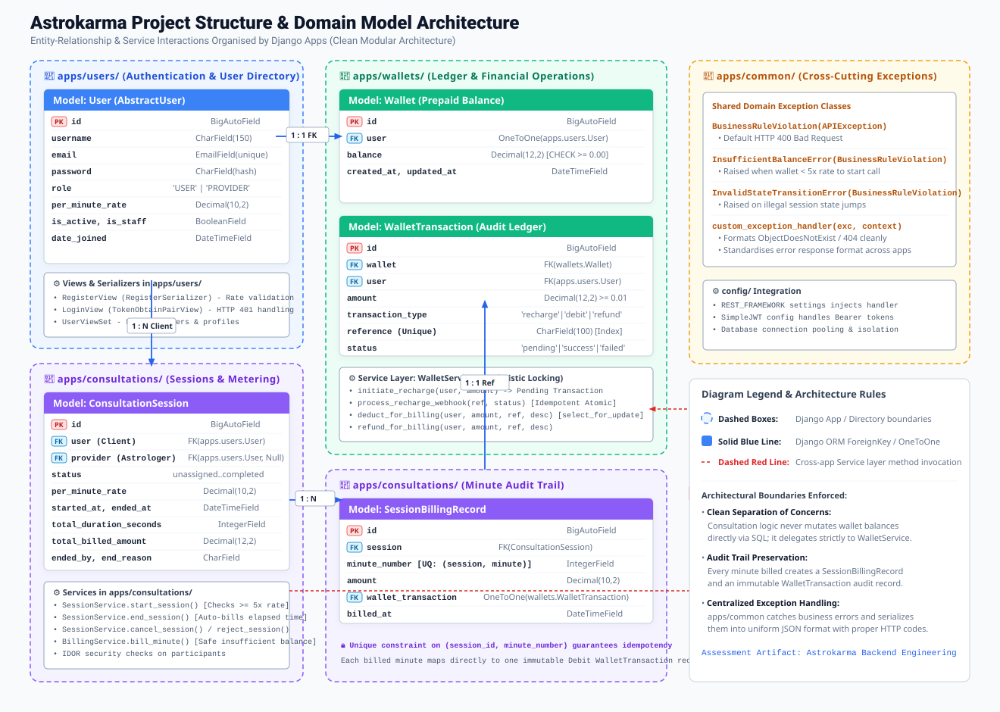
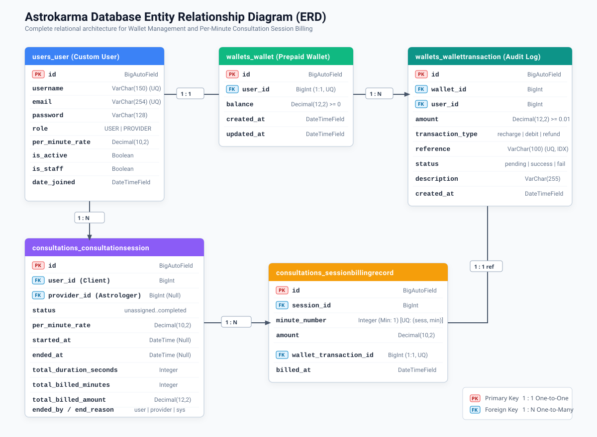
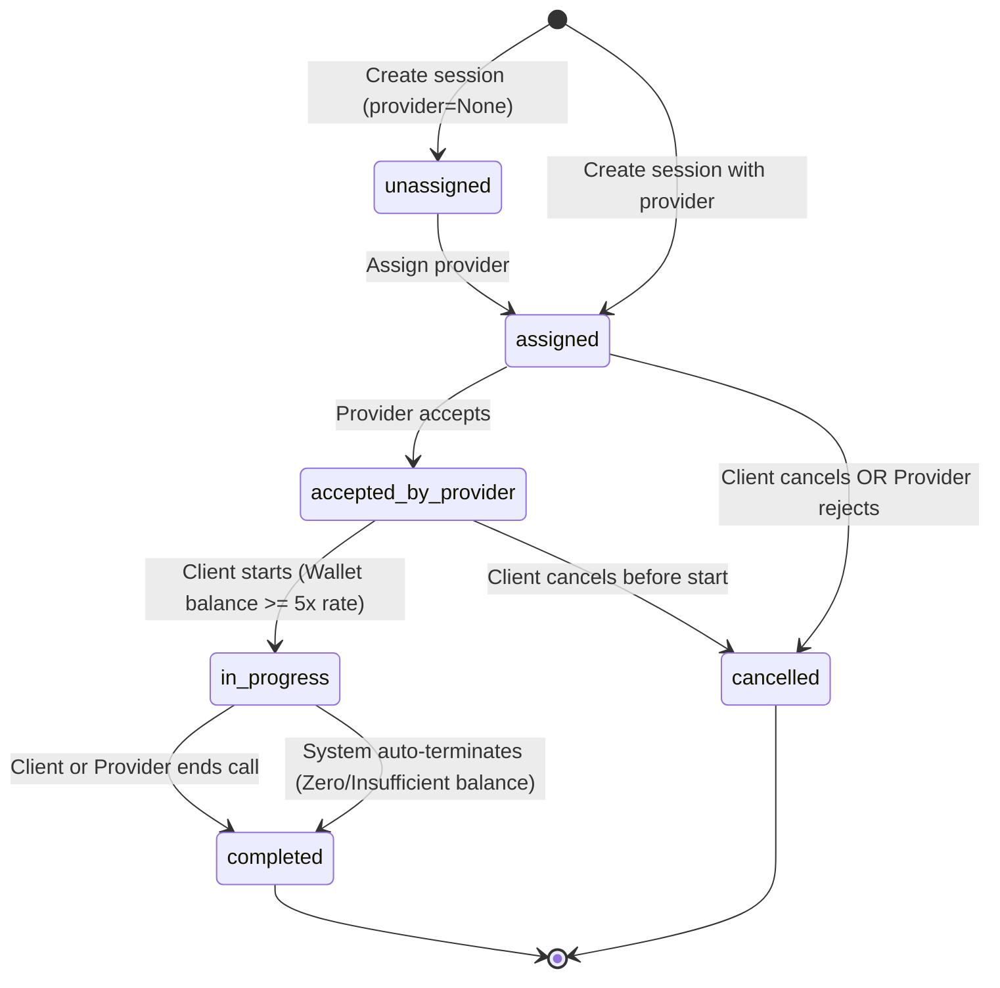

# Astrokarma Backend Engineering Assessment: Wallet-Based Session Billing

This repository contains the backend implementation for the **Astrokarma Backend Engineering Assessment**. It implements a wallet management and real-time per-minute billing system for 1:1 consultation sessions between users (clients) and service providers (astrologers) using **Django**, **Django REST Framework (DRF)**, and **PostgreSQL**.

---

## 1. Project Structure & Architecture

The codebase follows a modular clean architecture where each domain is encapsulated within a separate Django app:

```text
Astrokarma - Django Wallet-Based/
├── er_diagram_project_structure.svg # ER & Domain Architecture Diagram based on project structure
├── er_diagram.svg                   # Relational Database Schema ER Diagram (tables, keys, types)
├── ER_DIAGRAM.md                    # Detailed data dictionary, SQL constraints & cardinality matrix
├── postman_collection.json          # Pre-configured Postman test suite with variable scripts
├── pytest.ini                       # Test suite runner configuration
├── requirements.txt                 # Project dependencies
├── manage.py
├── config/                          # Project configuration, database settings & root routing
│   ├── settings.py
│   ├── urls.py
│   └── wsgi.py
└── apps/                            # Domain applications
    ├── users/                       # Custom User model (USER & PROVIDER roles, rates, auth APIs)
    ├── wallets/                     # Prepaid Wallet & Ledger transactions, atomic recharge callbacks
    ├── consultations/               # Consultation sessions, minute-level billing & state machine
    └── common/                      # Shared business exceptions and centralized 400/404 handler
```

---

## 2. Entity Relationship (ER) Diagrams

To provide both architectural clarity and database-level precision, two dedicated vector ER diagrams are provided:

1. **Project Structure ER Diagram (`er_diagram_project_structure.svg`)**: Visualizes how models, services, and domain logic are partitioned into the Django apps (`apps/users`, `apps/wallets`, `apps/consultations`, `apps/common`) and how they interact across app boundaries.
2. **Database Relational ER Diagram (`er_diagram.svg`)**: Details the physical PostgreSQL schema, table columns, primary/foreign keys, constraints, and cardinalities.

### A. ER Diagram Based on Project Structure
This diagram maps models and domain services directly to their respective Django app directories:



*File reference: [`er_diagram_project_structure.svg`](er_diagram_project_structure.svg)*

---

### B. Relational Database Schema ER Diagram
This diagram shows the underlying relational database tables, attributes, constraints, and foreign key relationships:



*File reference: [`er_diagram.svg`](er_diagram.svg)*

---

### App-to-Database Model Mapping Table

| App | Entity | Database Table | Key Attributes & Role |
|---|---|---|---|
| **`apps.users`** | `User` | `users_user` | Client & provider credentials, role enum, and provider consultation rate |
| **`apps.wallets`** | `Wallet` | `wallets_wallet` | User prepaid balance with non-negative constraint (`balance >= 0.00`) |
| **`apps.wallets`** | `WalletTransaction` | `wallets_wallettransaction` | Immutable financial ledger for recharges and session debits (idempotent references) |
| **`apps.consultations`** | `ConsultationSession` | `consultations_consultationsession` | Call lifecycle state machine, locked per-minute rates, and duration tracking |
| **`apps.consultations`** | `SessionBillingRecord` | `consultations_sessionbillingrecord` | Minute-by-minute audit trail with unique `(session_id, minute_number)` constraint |

> 📄 **Complete Schema Specification:**
> For the complete data dictionary, field-by-field SQL types, nullability, unique keys, and relationship cardinality rules, refer to: **[ER_DIAGRAM.md](ER_DIAGRAM.md)**.

---

## 3. Session Lifecycle (State Machine)

A consultation moves through strict, validated state transitions:



### Business Rules Enforced
- **5x Minimum Balance Requirement:** A client must have at least 5 minutes worth of consultation fees in their wallet before a session can transition to `in_progress`.
- **Single Active Session Rule:** Neither a client nor a provider can be in more than one active (`in_progress`) consultation at any given time.
- **Self-Consultation Prevention:** Users cannot book consultations with themselves.
- **Rate Lock Guarantee:** Once accepted, `session.per_minute_rate` is locked and cannot be inflated by subsequent provider profile updates.

---

## 4. Key Implementation Decisions

### A. Preventing Concurrency Issues & Race Conditions
All balance checks and balance modifications use PostgreSQL row-level pessimistic locking (`select_for_update()`) inside atomic database transactions (`transaction.atomic()`). This ensures that simultaneous recharge callbacks, minute ticks, and session requests are serialized, preventing negative balances or double debits.

### B. Minute-Level Billing Idempotency
To guarantee that network retries or duplicate cron ticks never overcharge a client, the `SessionBillingRecord` table enforces a database-level unique constraint on `(session_id, minute_number)`. If a tick for minute $N$ is re-sent, the system detects the existing record and skips the charge safely.

### C. Automatic Billing on Call End
If a user talks for 7 minutes and clicks "End", billing for any unbilled minutes up to that moment is settled automatically inside `end_session` before marking the session as `completed`. This prevents users from getting free minutes if a periodic billing worker hasn't ticked yet.

### D. Safe Auto-Termination on Zero Balance
During in-progress billing ticks, if the wallet cannot cover the next full minute, the system does not deduct into a negative balance. Instead, it marks the session as `completed` with `ended_by = "system"` and `end_reason = "Insufficient Balance"`. The database constraint `wallet_balance_non_negative` (`balance >= 0.00`) acts as the final safeguard.

### E. Service Layer Architecture
Business rules live inside dedicated domain services (`WalletService`, `SessionService`, `BillingService`) in `services.py`. Views and serializers only handle request parsing, authentication, permissions, and HTTP status codes.

---

## 5. Setup & Running Locally

### Prerequisites
- Python 3.11+
- PostgreSQL (or SQLite for local assessment evaluation)

### 1. Clone & Set Up Virtual Environment
```bash
# Clone the repository
git clone <repo-url>
cd "Astrokarma - Django Wallet-Based"

# Create virtual environment
python -m venv venv

# Activate virtual environment
# Windows:
.\venv\Scripts\activate
# Linux/macOS:
source venv/bin/activate

# Install dependencies
pip install -r requirements.txt
```

### 2. Configure Environment
Copy `.env.example` to `.env`:
```bash
cp .env.example .env
```

Ensure your database credentials match your PostgreSQL instance:
```ini
DEBUG=True
SECRET_KEY=django-insecure-astrokarma-assessment-secret-key
ALLOWED_HOSTS=*

# PostgreSQL Database Configuration
DB_NAME=astrokarma_db
DB_USER=postgres
DB_PASSWORD=postgres
DB_HOST=localhost
DB_PORT=5432

# Optional Payment Webhook Secret (Leave empty to disable signature checks during manual testing)
WEBHOOK_SECRET=
```

### 3. Run Migrations & Start Server
```bash
python manage.py migrate
python manage.py runserver
```

The API will be available at `http://127.0.0.1:8000/`.

---

## 6. Running the Test Suite

The automated test suite verifies all mandatory assessment scenarios, edge cases, and security boundaries.

Run all tests via pytest:
```bash
pytest -v
```

### Summary of Covered Scenarios (32 Tests Passing):
1. **Insufficient Balance to Start:** User with `< 5x` rate balance cannot start a session.
2. **Happy Path Lifecycle:** Recharge $\rightarrow$ Create $\rightarrow$ Accept $\rightarrow$ Start $\rightarrow$ Bill $\rightarrow$ End $\rightarrow$ Verified wallet balance deduction.
3. **Mid-Session Balance Exhaustion:** System auto-terminates session when balance is depleted; `ended_by="system"` and `end_reason="Insufficient Balance"`; wallet remains $\ge 0$.
4. **Auto-Billing on Call End:** Ending an active session automatically settles all unbilled minutes up to the end timestamp.
5. **State Transition Validations:** Premature or invalid state transitions return clean `HTTP 400` errors.
6. **Recharge Idempotency:** Duplicate successful webhook callbacks credit the wallet exactly once.
7. **Minute Billing Idempotency:** Repeated billing ticks for the same minute number do not charge twice.
8. **Single Active Session Constraint:** Neither client nor provider can join concurrent active sessions.
9. **Self-Consultation Prevention:** Users cannot book sessions with themselves.
10. **Cancellation & Rejection:** Verified `cancel` (client) and `reject` (provider) flows.
11. **IDOR & Authorization Protection:** Non-participants cannot trigger billing on other users' sessions.
12. **404 Handling:** Non-existent IDs return structured `HTTP 404` responses instead of unhandled 500 crashes.
13. **Reference Collision Guard:** Users cannot reuse another user's recharge reference.
14. **Pagination:** Wallet transactions endpoint correctly paginates records.
15. **User Auth Validations:** Case-insensitive email uniqueness check and `HTTP 401` on bad credentials.

---

## 7. Postman Collection & Manual Testing Guide

A complete, pre-configured Postman collection is included in the root directory: **[`postman_collection.json`](postman_collection.json)**.

### How to Import & Use:
1. Open **Postman** and click **Import** $\rightarrow$ select [`postman_collection.json`](postman_collection.json).
2. The collection has collection variables (`base_url`, `client_token`, `provider_token`, `provider_id`, `session_id`).
3. Running the requests in order automatically updates the tokens and IDs via embedded test scripts:

### Recommended Execution Sequence:

| Step | Folder | Request | Notes |
|:---:|---|---|---|
| **1** | `1. Authentication` | **Register Client (USER)** | Automatically sets `client_token` |
| **2** | `1. Authentication` | **Register Provider (PROVIDER)** | Automatically sets `provider_token` and `provider_id` |
| **3** | `2. Wallet & Recharge` | **Get Wallet Balance** | Verifies initial balance is ₹0.00 |
| **4** | `2. Wallet & Recharge` | **Initiate Wallet Recharge** | Initiates mock recharge for ₹500.00 |
| **5** | `2. Wallet & Recharge` | **Mock Recharge Webhook Callback** | Credits wallet with ₹500.00 (idempotent) |
| **6** | `2. Wallet & Recharge` | **Get Paginated Transactions** | Shows paginated transaction history |
| **7** | `3. Consultation Sessions` | **Create Session** | Creates session and sets `session_id` |
| **8** | `3. Consultation Sessions` | **Provider Accepts Session** | Provider moves session to `accepted_by_provider` |
| **9** | `3. Consultation Sessions` | **Client Starts Session** | Verifies 5x balance & transitions to `in_progress` |
| **10** | `3. Consultation Sessions` | **Trigger Minute Billing Tick** | Simulates billing ticks (e.g., target 2 minutes) |
| **11** | `3. Consultation Sessions` | **End Session** | Client or provider ends call & settles pending minutes |
| **12** | `3. Consultation Sessions` | **Get Session Details** | Shows completed session, duration, and billing records |
| **13** | `3. Consultation Sessions` | **Cancel / Reject Session** | Demonstrates pre-call cancellation flows |
