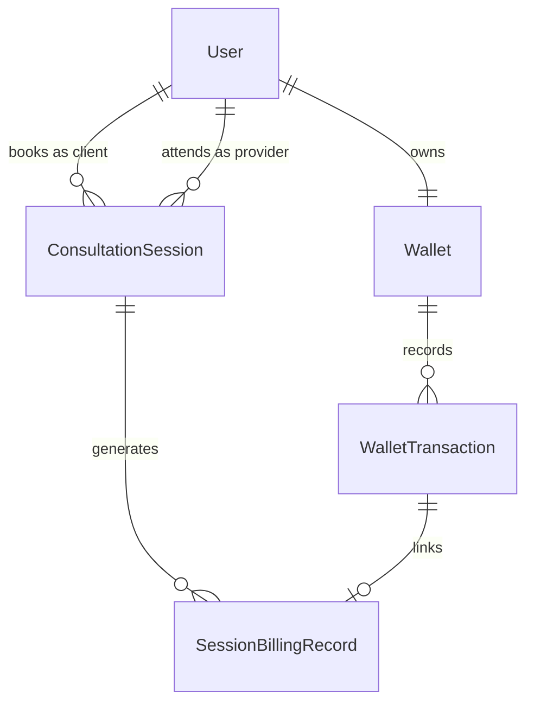
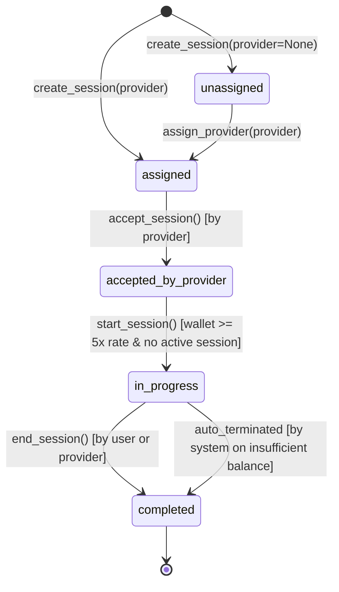

# Django Wallet-Based Per-Minute Session Billing

Backend system for a paid 1:1 consultation session built with **Django**, **Django REST Framework (DRF)**, and **PostgreSQL**.

---

## 1. System Architecture & Low-Level Design (LLD)

The codebase follows Clean Architecture with a strict domain service layer:

- **`apps.users`**: Custom `User` model with `USER` and `PROVIDER` roles and provider rates.
- **`apps.wallets`**: `Wallet` and `WalletTransaction` models with `WalletService` encapsulating atomic recharges, callbacks, and debits with database-level row locking (`select_for_update()`).
- **`apps.consultations`**: `ConsultationSession` and `SessionBillingRecord` models with `SessionService` (state machine lifecycle) and `BillingService` (per-minute calculation, idempotency, auto-termination).
- **`apps.common`**: Custom domain exceptions (`BusinessRuleViolation`, `InsufficientBalanceError`, `InvalidStateTransitionError`, `ActiveSessionExistsError`) mapped automatically to `HTTP 400` with clean error payloads.

---

## 2. Entity Relationship (ER) Diagram



---

## 3. Session State Machine



### State Transition Rules
- Transitions outside the allowed path raise `InvalidStateTransitionError` returning `HTTP 400`.
- Only the assigned provider can accept the session.
- Only the session owner can start the session.
- A user cannot start a session if they already have an `in_progress` session.
- Minimum balance to start: `5 × provider.per_minute_rate`.
- Once started, `per_minute_rate` is locked on the session object.

---

## 4. Per-Minute Billing & Insufficient Balance Logic

1. **Minute-Level Idempotency**:
   - `SessionBillingRecord` enforces a unique constraint on `(session_id, minute_number)`.
   - Repeated billing ticks for the same minute number will never double-debit the user.
2. **Atomic Balance Checks**:
   - Every billing tick locks the user's wallet row using `select_for_update()` inside `transaction.atomic()`.
3. **Graceful Auto-Termination on Insufficient Funds**:
   - If `wallet.balance < session.per_minute_rate` during any minute tick:
     - The wallet is **never deducted** into negative balance.
     - The session is immediately marked as `COMPLETED`.
     - `ended_by = "system"`.
     - `end_reason = "Insufficient Balance"`.
     - Actual duration and already billed minutes are safely persisted.

---

## 5. Important Implementation Decisions

| Decision | Rationale |
|---|---|
| **Pessimistic Locking (`select_for_update`)** | Prevents race conditions during concurrent wallet recharges, callbacks, and periodic billing ticks. |
| **Database Constraints** | `wallet_balance_non_negative` (`balance >= 0.00`) and unique `(session, minute_number)` guarantee integrity at the DB layer, independent of application code. |
| **Separation of Services & Views** | Business logic (state transitions, balance checks, mathematical ceiling) resides strictly in `services.py`, keeping serializers and views clean and focused on HTTP transport. |
| **Domain Exceptions -> DRF 400 Handler** | Domain exceptions (`BusinessRuleViolation`) bubble up to a unified exception handler, standardizing `{"error": "...", "code": "..."}` responses across all endpoints. |
| **Idempotent Webhooks** | Recharges use unique `reference` IDs. If a duplicate successful webhook callback is received, the service returns the existing transaction without crediting the wallet again. |

---

## 6. Setup & Running Locally

### Prerequisites
- Python 3.11+
- PostgreSQL 15+

### 1. Clone & Setup Virtual Environment
```bash
git clone <repo-url>
cd "Astrokarma - Django Wallet-Based"

# Create and activate virtual environment
python -m venv venv
# Windows:
.\venv\Scripts\activate
# Linux/macOS:
source venv/bin/activate

# Install dependencies
pip install -r requirements.txt
```

### 2. Configure Environment
Copy `.env.example` to `.env`:
```bash
cp .env.example .env
```

Ensure your PostgreSQL credentials in `.env` match your local PostgreSQL instance:
```ini
DB_NAME=astrokarma_db
DB_USER=postgres
DB_PASSWORD=postgres
DB_HOST=localhost
DB_PORT=5432
```

### 3. Run Migrations & Server
```bash
python manage.py migrate
python manage.py runserver
```

---

## 7. Running the Test Suite

The test suite thoroughly verifies all 6 mandatory assessment scenarios plus additional edge cases:

```bash
pytest -v
```

### Verified Test Scenarios (32 Comprehensive Tests):
1. `test_scenario_1_insufficient_balance_to_start`: User with `< 5x` cost cannot start a session.
2. `test_scenario_2_happy_path`: Recharge -> Create -> Provider accepts -> Start -> 2-min billing -> End session -> Wallet debited accurately.
3. `test_scenario_3_balance_runs_out`: Mid-session balance exhaustion -> Auto-terminated by system -> `ended_by="system"` -> `reason="Insufficient Balance"` -> Wallet never negative.
4. `test_scenario_4_invalid_state_transition`: Premature end or invalid transitions return `HTTP 400`.
5. `test_duplicate_recharge_callback_is_idempotent`: Duplicate success webhook credits wallet exactly once.
6. `test_scenario_6_duplicate_billing`: Duplicate ticks for the same minute do not charge twice.
7. `test_single_active_session_restriction`: User cannot run 2 concurrent sessions in progress.
8. `test_api_invalid_transition_returns_400` & `test_api_insufficient_balance_returns_400`: REST API validation.
9. `test_end_session_auto_bills_elapsed_minutes`: Automatically bills elapsed minutes upon ending session.
10. `test_self_consultation_rejected`: Users cannot book a session with themselves.
11. `test_provider_concurrent_active_session_rejected`: Providers cannot take multiple active sessions simultaneously.
12. `test_cancel_session_by_user` & `test_reject_session_by_provider`: State machine cancellation flows.
13. `test_idor_billing_protection`: Third-party users cannot trigger billing on other users' sessions.
14. `test_non_existent_session_returns_404`: Clean 404 responses instead of unhandled 500s.
15. `test_initiate_recharge_reference_collision_cross_user_fails`: Prevents cross-user reference hijacking.
16. `test_cannot_succeed_already_failed_callback`: Prevents invalid transition from failed to success.
17. `test_deduct_negative_or_zero_fails`: Guards against negative/zero deduction exploits.
18. `test_webhook_secret_enforcement`: Verifies optional HMAC/secret header on webhook endpoint.
19. `test_wallet_transactions_pagination`: Validates standard pagination for transaction history.
20. `test_auth_validations`: Enforces unique email registration and HTTP 401 on bad credentials.

---

## 8. API Reference & Postman Collection

Import [`postman_collection.json`](postman_collection.json) directly into Postman. It includes automated test scripts to store auth tokens and `session_id` into collection variables for easy one-click testing.

### Authentication (`/api/v1/auth/`)
- `POST /register/` - Register user (`role`: `USER` or `PROVIDER`, `per_minute_rate`)
- `POST /login/` - Login and obtain Auth Token (returns 401 on bad credentials)
- `GET /me/` - Current authenticated user profile

### Wallet (`/api/v1/wallet/`)
- `GET /` - View current wallet balance and recent transactions
- `GET /transactions/` - Paginated wallet transaction history (`page`, `page_size`)
- `POST /recharge/initiate/` - Initiate a mock recharge:
  ```json
  { "amount": "500.00", "reference": "rech_123" }
  ```
- `POST /recharge/callback/` - Mock payment webhook (Idempotent, supports `X-Webhook-Secret`):
  ```json
  { "reference": "rech_123", "status": "success" }
  ```

### Sessions (`/api/v1/sessions/`)
- `POST /` - Create session (`{"provider_id": 2}`)
- `GET /` - List user / provider sessions
- `GET /{id}/` - Retrieve session details with billing history
- `POST /{id}/assign/` - Assign session to provider (`{"provider_id": 2}`)
- `POST /{id}/accept/` - Provider accepts session
- `POST /{id}/reject/` - Provider declines session (`{"reason": "Unavailable"}`)
- `POST /{id}/cancel/` - Client cancels session (`{"reason": "Change of plans"}`)
- `POST /{id}/start/` - User starts session (checks min 5x rate balance & provider availability)
- `POST /{id}/end/` - User or provider ends session (auto-bills remaining minutes)
- `POST /{id}/bill/` - Trigger billing tick (protected against IDOR)
